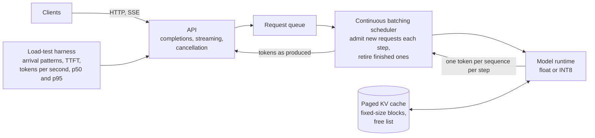

# llm-inference-server

An inference server for small transformer language models that shows, with measurements,
what the standard serving techniques buy: continuous batching, a paged key-value cache,
INT8 quantization and token streaming. Every technique is compared against a naive
server that handles one request at a time, on the same hardware and the same load.

> **Status:** design stage. The design doc and roadmap are written; the naive baseline
> and the load-test harness come first, because nothing else can be measured without
> them. No throughput or latency figure appears here until the harness has produced it.

## Why

Serving a language model is a scheduling problem as much as a modelling one. A request
needs many forward passes, requests arrive at different times and finish at different
lengths, and each one carries a growing cache. Handling them one at a time wastes most
of the hardware. The techniques that fix this are well known and usually met inside
large systems where they are hard to isolate. Here each one is a small, tested module
with a before-and-after number.

## How it will work



| Part | What it does |
|---|---|
| Baseline | One request at a time, start to finish; the number everything else is compared with |
| Continuous batching | New requests join the running batch at the next decoding step instead of waiting for it to finish |
| Paged KV cache | Attention keys and values stored in fixed-size blocks from a shared pool, so sequences of different lengths share memory without copying |
| Quantization | INT8 weights with measured effect on speed, memory and output quality |
| Streaming | Server-sent events, one token at a time, with cancellation when the client disconnects |
| Load-test harness | Replays arrival patterns and reports time to first token, tokens per second and latency percentiles |

In its last milestones the server loads and serves checkpoints trained by
[tiny-llm](https://github.com/mohammadazam7/tiny-llm).

## The baseline, in simulated time

The first number to beat: one request at a time, on a simulated model where each forward
pass costs 10 ms plus 2 ms per sequence in the batch. 200 requests arrive at random
(Poisson), each with a 16 to 128 token prompt and 16 to 256 new tokens. Reproduce any row
with `llm-loadtest --rate <rate>`.

| Arrival rate | Throughput | TTFT p50 | TTFT p95 | Latency p95 |
|---|---|---|---|---|
| 0.25 req/s | 32.2 tokens/s | 0.012 s | 2.5 s | 4.4 s |
| 0.5 req/s | 62.8 tokens/s | 1.7 s | 7.8 s | 10.1 s |
| 0.6 req/s | 72.7 tokens/s | 4.2 s | 14.0 s | 15.6 s |
| 1 req/s | 83.1 tokens/s | 42.4 s | 98.4 s | 101.4 s |
| 2 req/s | 83.3 tokens/s | 100.6 s | 196.1 s | 199.1 s |

Throughput stops at 83.3 tokens/s, one token per 12 ms step, because the baseline only
ever runs a batch of one. A request needs about 1.6 s of model time on average, so above
roughly 0.6 requests per second the queue grows without limit and time to first token
is mostly waiting. That ceiling is what continuous batching (M2) is meant to lift.

These are simulated times from the cost model above, not measurements of real hardware.
Real numbers come when the server runs tiny-llm checkpoints.

## Honest limits

There is no GPU here. All measurements are on a CPU with small models, and each results
table states the hardware. The relative gains from batching and caching carry over to
larger systems; the absolute numbers do not.

## Documentation

- [Design doc](docs/design.md): goals, non-goals, design, alternatives, testing plan
- [Roadmap](docs/ROADMAP.md): milestones and dates

## Development

```bash
python -m venv .venv && source .venv/bin/activate
make install
make check
```

See [CONTRIBUTING.md](CONTRIBUTING.md) and [SECURITY.md](SECURITY.md).

## License

MIT
