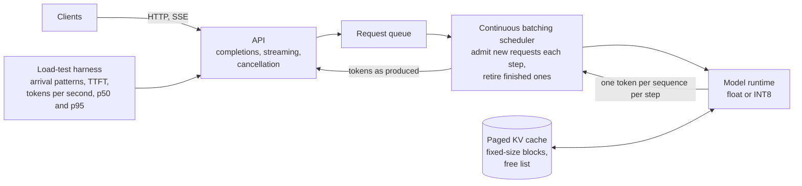

# llm-inference-server

An inference server for small transformer language models that shows, with measurements,
what the standard serving techniques buy: continuous batching, a paged key-value cache,
INT8 quantization and token streaming. Every technique is compared against a naive
server that handles one request at a time, on the same hardware and the same load.

> **Status:** milestone 2. The baseline, the load-test harness, the streaming HTTP API
> and the batching schedulers are in place; the paged KV cache comes next. Every
> throughput and latency figure here was produced by the harness, in simulated time.

## Why

Serving a language model is a scheduling problem as much as a modelling one. A request
needs many forward passes, requests arrive at different times and finish at different
lengths, and each one carries a growing cache. Handling them one at a time wastes most
of the hardware. The techniques that fix this are well known and usually met inside
large systems where they are hard to isolate. Here each one is a small, tested module
with a before-and-after number.

## How it will work



| Part | What it does |
|---|---|
| Baseline | One request at a time, start to finish; the number everything else is compared with |
| Continuous batching | New requests join the running batch at the next decoding step instead of waiting for it to finish |
| Paged KV cache | Attention keys and values stored in fixed-size blocks from a shared pool, so sequences of different lengths share memory without copying |
| Quantization | INT8 weights with measured effect on speed, memory and output quality |
| Streaming | Server-sent events, one token at a time, with cancellation when the client disconnects |
| Load-test harness | Replays arrival patterns and reports time to first token, tokens per second and latency percentiles |

In its last milestones the server loads and serves checkpoints trained by
[tiny-llm](https://github.com/mohammadazam7/tiny-llm).

## The baseline, in simulated time

The first number to beat: one request at a time, on a simulated model where each forward
pass costs 10 ms plus 2 ms per sequence in the batch. 200 requests arrive at random
(Poisson), each with a 16 to 128 token prompt and 16 to 256 new tokens. Reproduce any row
with `llm-loadtest --rate <rate>`.

| Arrival rate | Throughput | TTFT p50 | TTFT p95 | Latency p95 |
|---|---|---|---|---|
| 0.25 req/s | 32.2 tokens/s | 0.012 s | 2.5 s | 4.4 s |
| 0.5 req/s | 62.8 tokens/s | 1.7 s | 7.8 s | 10.1 s |
| 0.6 req/s | 72.7 tokens/s | 4.2 s | 14.0 s | 15.6 s |
| 1 req/s | 83.1 tokens/s | 42.4 s | 98.4 s | 101.4 s |
| 2 req/s | 83.3 tokens/s | 100.6 s | 196.1 s | 199.1 s |

Throughput stops at 83.3 tokens/s, one token per 12 ms step, because the baseline only
ever runs a batch of one. A request needs about 1.6 s of model time on average, so above
roughly 0.6 requests per second the queue grows without limit and time to first token
is mostly waiting. That ceiling is what batching lifts.

## Batching, on the same traffic

Three servers, the same 200 requests and the same simulated model (10 ms per forward
pass plus 2 ms per sequence), at most 8 sequences per pass. Static batching fills a batch
and runs it until its longest sequence is done. Continuous batching decides who is in the
batch again at every step. Reproduce a rate with `llm-loadtest --server all --rate <rate>`.

| Arrival rate | Server | Throughput | TTFT p50 | TTFT p95 | Latency p95 |
|---|---|---|---|---|---|
| 1 req/s | one at a time | 83.1 tokens/s | 42.4 s | 98.4 s | 101.4 s |
| | static batches | 125.3 tokens/s | 1.3 s | 4.2 s | 7.6 s |
| | continuous | 127.3 tokens/s | 0.022 s | 0.031 s | 4.1 s |
| 2 req/s | one at a time | 83.3 tokens/s | 100.6 s | 196.1 s | 199.1 s |
| | static batches | 174.3 tokens/s | 17.4 s | 40.8 s | 45.3 s |
| | continuous | 243.4 tokens/s | 0.035 s | 2.2 s | 6.6 s |
| 4 req/s | one at a time | 83.3 tokens/s | 130.3 s | 245.4 s | 248.4 s |
| | static batches | 177.6 tokens/s | 44.2 s | 89.0 s | 92.4 s |
| | continuous | 302.0 tokens/s | 12.4 s | 29.3 s | 33.5 s |

At 2 requests per second the baseline is far behind and continuous batching
answers in 35 ms at the median. Its ceiling is 8 tokens per 26 ms step, about 308
tokens/s, and at 4 requests per second it reaches that and starts to queue too. Static
batching stops near 178 tokens/s: a sequence that finishes early keeps its slot until the
longest one in its batch is done, so much of each pass is spent on padding.

### When batching does not help

The gain above comes from the fixed 10 ms that a batch shares. On a model where a pass
costs nothing fixed and 12 ms per sequence (one CPU core, roughly), the same comparison
at 2 requests per second gives:

| Server | Throughput | TTFT p50 | Latency p95 |
|---|---|---|---|
| one at a time | 83.3 tokens/s | 100.6 s | 199.1 s |
| static batches | 49.1 tokens/s | 200.8 s | 417.1 s |
| continuous | 83.3 tokens/s | 94.5 s | 206.9 s |

Continuous batching buys no throughput here, and static batching is worse than no
batching at all because the padding is now paid for in full. At a light 0.5 requests per
second continuous batching still starts answering sooner (TTFT p50 0.047 s against
1.7 s) but finishes the slowest requests later (latency p95 15.9 s against 10.1 s),
because sequences that share a pass slow each other down. Whether batching pays depends
on the hardware, which is the open question the design doc set out to answer
(`--step-cost 0 --per-sequence-cost 0.012` reproduces these).

These are simulated times from the cost model above, not measurements of real hardware.
Real numbers come when the server runs tiny-llm checkpoints.

## The HTTP API

`llm-serve` still runs the one-at-a-time baseline behind `POST /v1/generate` (the
batcher goes behind it in the next milestone), with the simulated model
sleeping for its step cost so the server takes real time like a real model would:

```bash
pip install -e ".[serve]"
llm-serve --port 8000
curl -N localhost:8000/v1/generate -H "content-type: application/json" \
  -d '{"prompt": [1, 2, 3], "max_new_tokens": 5, "stream": true}'
```

```text
event: token
data: {"index": 0, "token": 149}
...
event: done
data: {"tokens": 5, "finish_reason": "length"}
```

Without `"stream": true` the reply is one JSON body, `{"tokens": [...], "finish_reason":
"length"}`. Prompts are token ids for now; text goes in once tiny-llm's tokenizer is
wired up. Requests queue for the model in arrival order. If a client disconnects
mid-stream, the model is released at the next token it fails to deliver rather than
running to `max_new_tokens` for nobody; `GET /v1/stats` counts served and cancelled
requests.

## Honest limits

There is no GPU here. All measurements are on a CPU with small models, and each results
table states the hardware. The relative gains from batching and caching carry over to
larger systems; the absolute numbers do not.

## Documentation

- [Design doc](docs/design.md): goals, non-goals, design, alternatives, testing plan
- [Roadmap](docs/ROADMAP.md): milestones and dates

## Development

```bash
python -m venv .venv && source .venv/bin/activate
make install
make check
```

See [CONTRIBUTING.md](CONTRIBUTING.md) and [SECURITY.md](SECURITY.md).

## License

MIT
